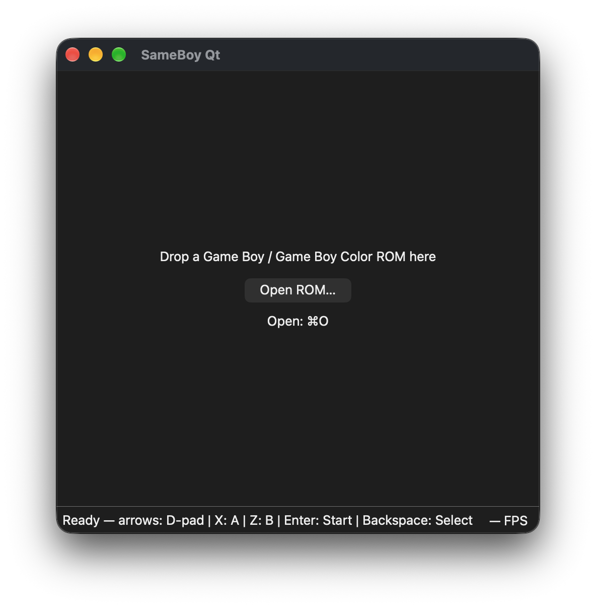

# SameBoy Qt

A cross-platform Game Boy / Game Boy Color emulator: a Qt 6 frontend for the accurate
[SameBoy](https://github.com/LIJI32/SameBoy) core, used unmodified as a submodule.

## Download

Get the latest build from the [Releases](https://github.com/TomJinW/SameBoy-qt/releases) page:

- **Windows x64** — unpack the folder and run `bin/sameboy-qt.exe` (portable: settings are kept beside the program).
- **macOS (Apple Silicon)** — `sameboy-qt.app`. It is not notarized: run `xattr -cr sameboy-qt.app` to remove the `com.apple.quarantine` attribute before the first launch.
- **Linux x64 / arm64** — an AppImage; make it executable (`chmod +x`) and run it.

No game ROMs are included; open your own `.gb` / `.gbc` files. Open-source boot ROMs are built in, so no
Nintendo firmware is needed.

## Quick start

1. **Open a game**: click *Open ROM…*, drop a `.gb` / `.gbc` file onto the window, use File → Open ROM, or pass the
   path on the command line (`sameboy-qt game.gb`).
2. **Play** with the keyboard or a game controller. Default keys (Ctrl is ⌘ on macOS):

   | Game Boy | Key | | Action | Key |
   | --- | --- | --- | --- | --- |
   | D-pad | Arrow keys | | Rewind (hold) | R |
   | A / B | X / Z | | Turbo (hold) / Slow motion (hold) | Tab / Shift |
   | Start / Select | Enter / Backspace | | Save / load state, slots 1–10 | Ctrl+1…0 / Ctrl+Shift+1…0 |
   | Pause | Ctrl+P | | Screenshot | Ctrl+S |

3. **Adjust things** in Preferences (Ctrl+,): filters, palettes, audio, controllers, boot ROMs, and more.

All shortcuts, menus and controller options are listed in [Features and usage](docs/FEATURES.md).

## Highlights

- Accurate emulation of GB / GBC / SGB and more models, with keyboard, mouse, game controllers and Joy-Con (split or combined).
- Cheats, save states, real-time rewind, and 16 display filters (LCD, CRT, Scale2x, HQ2x, OmniScale and more).
- Link cable and infrared linking between two windows on the same computer.
- Game Boy Printer (saves PNG/PDF), Game Boy Camera (uses your webcam), MBC7 tilt cartridges (mouse or Switch controller).
- Screenshots, audio recording and H.264/MP4 video recording, with filters and integer scaling applied.
- VRAM and memory viewers, a command-line debugger, audio channel switches, and a debug interface for AI tools (command line and Python).
- A GBS music player; English and Simplified Chinese interface, light and dark themes.

## Platform support

| Platform | Release package | Built | Verified |
| --- | --- | --- | --- |
| Windows x64 | folder with `sameboy-qt.exe` (portable) | cross-compiled on a Mac with mingw-w64 | tested on Windows by the author |
| macOS 14+, Apple Silicon | `sameboy-qt.app` (ad-hoc signed, not notarized) | natively on a Mac | all 31 automated tests pass on a Mac |
| Linux x64 and arm64 | AppImage (Debian 13 / glibc 2.41 baseline) | in Apple Container | automated tests under a virtual display; real desktops not yet validated |

Real Bluetooth controllers, sound hardware and printers have not been validated on every platform.
A Windows ARM64 build script is kept for development, but no Windows ARM64 release is made.

## Build from source

| Target | Script | Run it on | Output |
| --- | --- | --- | --- |
| Windows x64 | `build-windows-x64.cmd` | Windows | `dist/windows-x64/bin/sameboy-qt.exe` |
| Windows x64 (cross-compile) | `build-windows-x64-apple-container.sh` | Apple Silicon Mac | `dist/windows-x64/bin/sameboy-qt.exe` |
| macOS arm64 | `build-macos-arm64.sh` | Apple Silicon Mac | `dist/macos-arm64/sameboy-qt.app` |
| Linux arm64 / x64 AppImage | `build-linux-apple-container.sh [arm64\|x64\|all] --appimage` | Apple Silicon Mac | `dist/linux-<arch>/*.AppImage` |
| Linux (native) | `build-linux.sh [--appimage]` | Linux | `dist/linux-<arch>/` |

Clone with `git clone --recurse-submodules`. Requirements, options, tests and troubleshooting are in
[Building from source](docs/BUILDING.md).

## Documentation

- [Features and usage](docs/FEATURES.md) — controls, menus, peripherals, recording, debugging, interface language.
- [Building from source](docs/BUILDING.md) — requirements and build steps for Windows x64, macOS and Linux (including cross-compiling and AppImage packaging).
- [Development notes](docs/DEVELOPMENT.md) — project structure, validation status and the icon tooling.
- [Debug interface for AI tools](docs/ai-debugging.txt) — JSON-RPC protocol, command line and Python examples.
- [Third-party licensing review](docs/third-party-review.txt)

## Acknowledgements

- [SameBoy](https://github.com/LIJI32/SameBoy) by LIJI32 — the emulation core and boot ROMs; its Cocoa frontend was the behavior reference for this Qt frontend.
- [Qt](https://www.qt.io/) for the interface, [FFmpeg](https://ffmpeg.org/) for video recording and [SDL](https://libsdl.org/) for game controller input.

SameBoy Qt is an independent project and is not affiliated with or endorsed by Nintendo. Game Boy is a trademark of Nintendo.

## License

The SameBoy Qt frontend is released under the [MIT License](LICENSE). The SameBoy core (the `SameBoy/` submodule)
and the boot ROMs are under SameBoy's own Expat license (`SameBoy/LICENSE`). Qt, FFmpeg and SDL keep their own
licenses; see `resources/licenses/THIRD-PARTY-NOTICES.txt` (installed with every package) and
[docs/third-party-review.txt](docs/third-party-review.txt).
